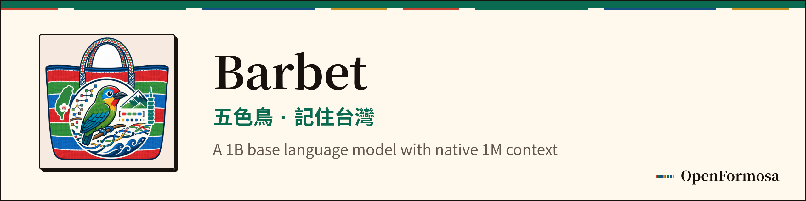

<p align="center"></p>

# Barbet

Barbet is OpenFormosa's family of base language models, and this repository is its Hugging Face Transformers implementation. The current release, `OpenFormosa/barbet-1b-base`, has about 1.119B parameters and a native context of 1,048,576 tokens.

<p align="center">
  <a href="LICENSE"></a>
  <a href="https://huggingface.co/OpenFormosa/barbet-1b-base"></a>
  
  <a href="https://discord.gg/N4YnrjjcW7"></a>
</p>

<p align="center"><a href="README.md">繁體中文</a> · <b>English</b></p>

<p align="center">
  <a href="https://huggingface.co/OpenFormosa/barbet-1b-base">Model</a> · <a href="model_cards/barbet-1b-base/README.md">Model card</a> · <a href="https://openformosa.com/blog/2026/08/30/barbet-1b-native-1m/">Technical article</a> · <a href="docs/">Docs</a> · <a href="https://openformosa.com/community/">Community</a>
</p>

## Why

OpenFormosa's speech, text, and vision models need a shared language backbone. The backbone must be small enough to fine-tune on an ordinary GPU. It must also read long inputs, such as a full document or the transcript of a whole meeting.

Barbet is that backbone. It uses the Taiwan-centric `OpenFormosa/PangolinTokenizer` vocabulary and was continually pretrained on sequences of exactly 1M tokens. BlueMagpie-TTS also uses Barbet for text understanding.

The name comes from the Taiwan barbet, a bird endemic to Taiwan.

## Quick start

1. Install Transformers:

   ```bash
   pip install "transformers>=4.57" torch
   ```

2. Load the model from Hugging Face:

   ```python
   from transformers import AutoModelForCausalLM, AutoTokenizer

   tokenizer = AutoTokenizer.from_pretrained("OpenFormosa/barbet-1b-base", trust_remote_code=True)
   model = AutoModelForCausalLM.from_pretrained(
       "OpenFormosa/barbet-1b-base",
       trust_remote_code=True,
       dtype="auto",
       device_map="auto",
   )
   ```

3. Run `print(model.config.max_position_embeddings)`. It prints `1048576`.

   `generate()`, batched generation and `pipeline("text-generation")` work out of the box. See [Transformers usage](docs/transformers_usage.md) (Traditional Chinese).

## Installation

| Item | Requirement |
| --- | --- |
| Python | 3.10 or later |
| Main dependencies | PyTorch ≥ 2.3, transformers ≥ 4.57 (tested on 4.57.6 and 5.24.1) |
| Hardware | CUDA GPU with `mamba_ssm` recommended; CPU uses a PyTorch fallback |

Install from source and run the tests:

```bash
pip install -e ".[dev]"
pytest -q
```

## Usage

### Build a model from a config

Use the built-in config when you want to change the architecture or train from scratch:

```python
from barbet import BarbetConfig, BarbetForCausalLM

config = BarbetConfig.barbet_1b_base()
model = BarbetForCausalLM(config)
```

This repository provides:

- `BarbetConfig`, `BarbetModel`, `BarbetForCausalLM`
- `configs/barbet_1b_base/config.json` (same as the Hub weights), `configs/barbet_1b/config.json`, `configs/barbet_1b_1m/config.json`
- `configuration_barbet.py` and `modeling_barbet.py` for remote-code loading from the Hugging Face Hub

### Inspect the config only

```python
from transformers import AutoConfig

config = AutoConfig.from_pretrained("OpenFormosa/barbet-1b-base", trust_remote_code=True)
```

The configs under `configs/` already include the `auto_map` fields needed for remote-code loading.

### Convert a checkpoint

Convert a Megatron `torch_dist` checkpoint to Hugging Face format:

```bash
python scripts/convert_torch_dist_to_hf.py \
  --checkpoint /path/to/megatron/checkpoint_dir \
  --output-dir /path/to/hf_export \
  --force
```

The converter writes the main causal-LM weights to `model.safetensors`.

### Configs and context length

Barbet is a decoder-only causal language model:

- It uses the fixed `OpenFormosa/PangolinTokenizer` vocabulary.
- Token embeddings and the LM head share weights.
- A hybrid cache supports incremental decoding and saves memory on long sequences.

The current release and the repository presets play different roles:

| Configuration | Purpose | Context length |
| --- | --- | ---: |
| `OpenFormosa/barbet-1b-base` | Current `iter7008` weights and bundled config | **Native 1M** |
| `configs/barbet_1b_base/` | Copy of the config shipped with the Hub weights | **Native 1M** |
| `configs/barbet_1b/` | Legacy R2 preset, kept for reproducibility | Native 256K |
| `configs/barbet_1b_1m/` | Legacy R2 inference extrapolation preset | 1M RoPE extrapolation |

The current `iter7008` release was continually pretrained on exact 1M sequences. It is not the legacy 256K weights stretched to 1M with RoPE scaling. Use the `config.json` published with the weights on the Hub.

## Results

The released checkpoint gives these results at exactly 1,048,576 tokens (details in the [model card](model_cards/barbet-1b-base/README.md)):

- A fresh-loaded checkpoint completed 140/140 exact-1M evaluation rows across 8/8 shards, with no OOM, NaN, or non-finite score.
- On seven frozen long-context tasks, 6 have a paired-bootstrap 95% CI lower bound above zero.
- Base-model BPB did not regress in any of the 6 buckets.
- Exact NIAH, opaque NIAH, multi-key, ordering, variable tracking, and three-hop chain pass. Aggregation is not yet proven.

**How to read this:** the model runs stably at 1M and can retrieve distant information. This does not mean it fully understands any million-token document.

## Documentation

- [Configuration](docs/configuration.md)
- [Transformers usage](docs/transformers_usage.md)
- [Checkpoint conversion](docs/checkpoint_conversion.md)
- [Long context](docs/long_context.md)
- [Development](docs/development.md)
- [Model card](model_cards/barbet-1b-base/README.md)
- [Native 1M training and evaluation report](https://openformosa.com/blog/2026/08/30/barbet-1b-native-1m/)

## Limitations

- Barbet 1B Base is a base model with no chat template, SFT, or RLHF. Use an instruction-tuned version for user-facing assistants.
- "Stable 1M" is a scoped capability claim. It does not mean full comprehension of arbitrary million-token documents. Aggregation is not yet proven.
- Running a true 1M context needs enough GPU memory, context parallelism, and compatible optimized kernels. A single consumer GPU is usually not enough.
- On CPU only, Mamba uses a PyTorch fallback. For decoding closest to the original model, install `mamba_ssm` and run on CUDA.
- Without decoding constraints, generations may repeat or drift off topic.

## Contributing

OpenFormosa is a community project. Everyone can be a contributor.

- Questions and discussion: [Discord](https://discord.gg/N4YnrjjcW7) or the [community page](https://openformosa.com/community/)
- Bugs and ideas: [Issues](https://github.com/OpenFormosa/Barbet/issues)
- Pull requests: read [CONTRIBUTING.md](https://github.com/OpenFormosa/openformosa.com/blob/main/CONTRIBUTING.md) first
- General contact: <hello@openformosa.com>
- Security: <security@openformosa.com> (please do not open a public issue)
- Code of conduct: [CODE_OF_CONDUCT.md](https://github.com/OpenFormosa/openformosa.com/blob/main/CODE_OF_CONDUCT.md); report to <conduct@openformosa.com>

## License

Code and documentation in this repository are released under the [Apache License 2.0](LICENSE), © 2026 OpenFormosa contributors.

Model weights are also released under the Apache License 2.0. Please follow the [OpenFormosa Acceptable Use Policy](https://openformosa.com/acceptable-use/).

## Acknowledgements

Compute and research support come from Taipei-1, NTU Speech Lab, and NTU SPML Lab. Thanks to everyone who opened an issue, sent a pull request, or joined the discussion.

## Citation

```bibtex
@misc{openformosabarbet2026,
  title  = {Barbet: A 1B Base Language Model with Native 1M Context},
  author = {{OpenFormosa contributors}},
  year   = {2026},
  url    = {https://github.com/OpenFormosa/Barbet}
}
```
