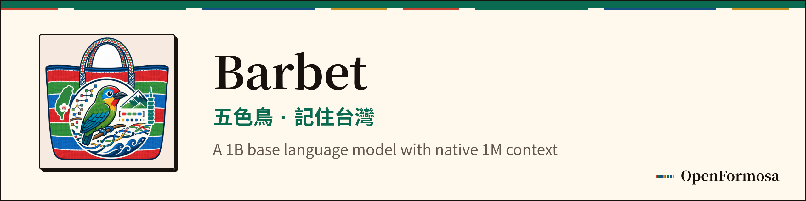

<p align="center"></p>

# Barbet

Barbet 是 OpenFormosa 的基礎語言模型系列，這個 repository 是它的 Hugging Face Transformers 實作。目前發布的 `OpenFormosa/barbet-1b-base` 約有 1.119B 參數，原生支援 1,048,576 token 的前後文。

<p align="center">
  <a href="LICENSE"></a>
  <a href="https://huggingface.co/OpenFormosa/barbet-1b-base"></a>
  
  <a href="https://discord.gg/N4YnrjjcW7"></a>
</p>

<p align="center"><b>繁體中文</b> · <a href="README.en.md">English</a></p>

<p align="center">
  <a href="https://huggingface.co/OpenFormosa/barbet-1b-base">模型</a> · <a href="model_cards/barbet-1b-base/README.md">模型卡</a> · <a href="https://openformosa.com/blog/2026/08/30/barbet-1b-native-1m/">技術文章</a> · <a href="docs/">文件</a> · <a href="https://openformosa.com/community/">社群</a>
</p>

## 為什麼做這個

OpenFormosa 的語音、文字與影像模型需要一個共同的語言底座。這個底座要小到能在一般 GPU 上微調。它也要能讀很長的內容，例如整份文件或一整段會議的逐字稿。

Barbet 就是這個底座。它使用台灣語言情境的 `OpenFormosa/PangolinTokenizer` 詞彙表，並在剛好 1M token 的序列上繼續預先訓練。BlueMagpie-TTS 也用 Barbet 負責文字語意。

名稱取自台灣特有種五色鳥。

## 快速開始

1. 安裝 Transformers：

   ```bash
   pip install "transformers>=4.57" torch
   ```

2. 從 Hugging Face 載入模型：

   ```python
   from transformers import AutoModelForCausalLM, AutoTokenizer

   tokenizer = AutoTokenizer.from_pretrained("OpenFormosa/barbet-1b-base", trust_remote_code=True)
   model = AutoModelForCausalLM.from_pretrained(
       "OpenFormosa/barbet-1b-base",
       trust_remote_code=True,
       dtype="auto",
       device_map="auto",
   )
   ```

3. 執行 `print(model.config.max_position_embeddings)`，會印出 `1048576`。

   `generate()`、批次生成與 `pipeline("text-generation")` 都能直接使用，詳見 [Transformers 使用方式](docs/transformers_usage.md)。

## 安裝

| 項目 | 需求 |
| --- | --- |
| Python | 3.10 以上 |
| 主要相依套件 | PyTorch ≥ 2.3、transformers ≥ 4.57（已實測 4.57.6 與 5.24.1） |
| 硬體 | CUDA GPU 建議搭配 `mamba_ssm`；只有 CPU 時使用 PyTorch 後備路徑 |

從原始碼安裝並執行測試：

```bash
pip install -e ".[dev]"
pytest -q
```

## 使用範例

### 從設定建立模型

想修改架構或從頭訓練時，用內建的設定直接建立模型：

```python
from barbet import BarbetConfig, BarbetForCausalLM

config = BarbetConfig.barbet_1b_base()
model = BarbetForCausalLM(config)
```

這個 repository 提供：

- `BarbetConfig`、`BarbetModel`、`BarbetForCausalLM`
- `configs/barbet_1b_base/config.json`（與 Hub 權重相同）、`configs/barbet_1b/config.json`、`configs/barbet_1b_1m/config.json`
- 供 Hugging Face Hub 以 remote code 載入的 `configuration_barbet.py` 與 `modeling_barbet.py`

### 只檢視設定

```python
from transformers import AutoConfig

config = AutoConfig.from_pretrained("OpenFormosa/barbet-1b-base", trust_remote_code=True)
```

`configs/` 底下的設定檔已經包含 remote code 載入所需的 `auto_map` 欄位。

### 轉換檢查點

把 Megatron `torch_dist` 檢查點轉換成 Hugging Face 格式：

```bash
python scripts/convert_torch_dist_to_hf.py \
  --checkpoint /path/to/megatron/checkpoint_dir \
  --output-dir /path/to/hf_export \
  --force
```

轉換器會把主要的 causal-LM 權重輸出成 `model.safetensors`。

### 設定與前後文長度

Barbet 是 decoder-only 的因果語言模型，有以下特點：

- 使用固定的 `OpenFormosa/PangolinTokenizer` 詞彙表。
- 詞嵌入與 LM head 共用權重。
- 支援逐步解碼的混合式快取，生成長序列時更省記憶體。

目前發布的權重與 repository 內建設定的關係如下：

| 設定 | 用途 | 前後文長度 |
| --- | --- | ---: |
| `OpenFormosa/barbet-1b-base` | 目前發布的 `iter7008` 權重與隨附設定 | **原生 1M** |
| `configs/barbet_1b_base/` | 與 Hub 權重一起發布的設定副本 | **原生 1M** |
| `configs/barbet_1b/` | 原始 R2 設定，供舊版研究重現 | 原生 256K |
| `configs/barbet_1b_1m/` | 原始 R2 的推論外推研究設定 | 1M RoPE 外推 |

目前發布的 `iter7008` 實際在剛好 1M 的序列上繼續預先訓練。它不是把舊版 256K 權重只靠 RoPE scaling 拉到 1M。請直接使用 Hub 上與權重一起發布的 `config.json`。

## 效果

目前發布的檢查點在剛好 1,048,576 token 的評測上得到以下結果（細節見[模型卡](model_cards/barbet-1b-base/README.md)）：

- 重新載入後完成 140/140 筆 1M 評測，8/8 個分片全部完成，沒有 OOM、NaN 或非有限值。
- 七類固定的長前後文任務中，6 類的配對 bootstrap 95% 信賴區間下界大於零。
- 基礎模型的 BPB 在 6/6 個分組都沒有比原始版本變差。
- Exact NIAH、opaque NIAH、multi-key、ordering、variable tracking、three-hop chain 通過。Aggregation 尚未證明。

**怎麼讀這些結果：** 模型在 1M 長度下能穩定執行，也能找回遠處的資訊。這不代表它能完整理解任意一百萬 token 的文件。

## 文件

- [設定](docs/configuration.md)
- [Transformers 使用方式](docs/transformers_usage.md)
- [檢查點轉換](docs/checkpoint_conversion.md)
- [長前後文](docs/long_context.md)
- [開發](docs/development.md)
- [模型卡](model_cards/barbet-1b-base/README.md)
- [Barbet 1B Base 的原生 1M：完整訓練與評測報告](https://openformosa.com/blog/2026/08/30/barbet-1b-native-1m/)

## 限制

- Barbet 1B Base 是基礎模型，沒有 chat template、SFT 或 RLHF。面向使用者的助理應用請改用經過指令微調的版本。
- 「stable 1M」是有範圍的能力描述，不代表能完整理解任意一百萬 token 的文件。Aggregation 尚未證明。
- 實際執行 1M 需要足夠的 GPU 記憶體、context parallelism 與相容的最佳化 kernel。單張消費級 GPU 通常不夠。
- 只有 CPU 時，Mamba 會使用 PyTorch 後備路徑。想得到最接近原始模型的解碼結果，請安裝 `mamba_ssm` 並在 CUDA 上執行。
- 沒有解碼限制時，生成內容可能重複或偏離主題。

## 參與貢獻

OpenFormosa 是社群專案，每個人都可以是貢獻者。

- 討論與提問：[Discord](https://discord.gg/N4YnrjjcW7) 或 [社群頁](https://openformosa.com/community/)
- 回報問題或提議功能：[Issues](https://github.com/OpenFormosa/Barbet/issues)
- 送出修改：請先讀 [CONTRIBUTING.md](https://github.com/OpenFormosa/openformosa.com/blob/main/CONTRIBUTING.md)
- 一般聯絡：<hello@openformosa.com>
- 安全問題：<security@openformosa.com>（請不要公開發 issue）
- 行為準則：[CODE_OF_CONDUCT.md](https://github.com/OpenFormosa/openformosa.com/blob/main/CODE_OF_CONDUCT.md)，回報請寄 <conduct@openformosa.com>

## 授權

本 repository 的程式碼與文件以 [Apache License 2.0](LICENSE) 釋出，© 2026 OpenFormosa contributors。

模型權重同樣以 Apache License 2.0 釋出。使用時請遵守 [OpenFormosa 可接受使用政策](https://openformosa.com/acceptable-use/)。

## 致謝

本專案的運算資源與研究支持來自 Taipei-1、臺大語音實驗室（NTU Speech Lab）與 NTU SPML Lab。感謝每一位提出問題、送出 PR 與參與討論的貢獻者。

## 引用

```bibtex
@misc{openformosabarbet2026,
  title  = {Barbet: A 1B Base Language Model with Native 1M Context},
  author = {{OpenFormosa contributors}},
  year   = {2026},
  url    = {https://github.com/OpenFormosa/Barbet}
}
```
